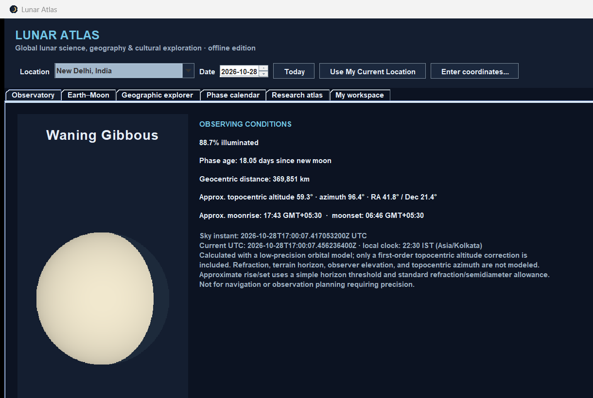

# Lunar Atlas

Lunar Atlas is an offline-first Java desktop application for exploring lunar phases, approximate observing conditions, documented calendar traditions, selected lunar history, and evidence-based explanations of Earth–Moon interactions.

> **Scope:** this is a small, sourced first release, not a precision ephemeris, eclipse-prediction system, tide forecast, comprehensive world atlas, or religious calendar authority. Unsupported values are identified as unavailable. Cultural records are context-specific and do not claim that lunar events cause human or terrestrial events.

## What works

- Select a date and one of seven built-in observation locations.
- Request a one-time Windows device location, or enter a manual name, latitude, longitude, and time zone; both update the existing observing, map, orbit, and workspace views.
- Calculate phase, illuminated fraction, phase age, approximate distance, right ascension/declination, topocentric altitude/azimuth, and approximate moonrise/moonset.
- View a clearly schematic Earth–Moon phase/orbit diagram and a selectable, graticule-only location map.
- Generate New Moon, Quarter, and Full Moon event times for ranges up to one year; view and export the selected phase events as CSV in UTC.
- Search a bundled sample of cultural calendar records, historical observations, and Earth-systems science notes, with source and uncertainty context.
- Save local investigation notes and bookmark built-in locations. User data is stored under `%APPDATA%\LunarAtlas`; no account or network is required.

Eclipse visibility, eclipse paths, perigee/apogee calendars, local tides, IP geolocation, PDF reports, and advanced calendar conversion are **not implemented**. See [LIMITATIONS.md](LIMITATIONS.md).

## Requirements

**End users:** Windows 10/11 x64; no separate Java installation is required when using the portable release ZIP.  
**Developers:** JDK 17+ and Maven 3.8+. The project targets Java 17 and is currently validated locally on JDK 25.

## Install / launch

Download a `LunarAtlas-Windows.zip` from the repository's [Releases](https://github.com/Rishu07368/lunar-atlas/releases) page when one is published. Extract the entire ZIP to a writable folder and run `LunarAtlas\LunarAtlas.exe`. Do not move or run the EXE without its `app` and `runtime` folders.

**No public release is published yet.** The source repository contains the Windows packaging workflow; portable artifacts are only claimed after they have actually been built and checked.

## Quick start

1. Launch Lunar Atlas; its bundled records work offline.
2. Select a built-in location, choose **Use My Current Location** for a one-time Windows location-service request (allow up to 20 seconds for a fix), or use **Enter coordinates…**. Enable both Windows Location services and **Let desktop apps access your location**; confirm the time zone because Windows coordinates do not include one.
3. Select a date in the top bar.
4. Use **Observatory** for calculated sky quantities and **Earth–Moon** for the schematic phase relationship.
5. Click a labeled city on **Geographic explorer**, or select it from the location menu.
6. In **Phase calendar**, choose a date range (maximum one year), calculate, and export visible results to CSV.
7. Search **Research atlas** for sourced cultural, historical, or science entries. Use **My workspace** to save notes and bookmark locations.

## Build and test

```powershell
mvn -B clean verify
java -jar target\lunar-atlas-0.1.0.jar
```

See [TESTING.md](TESTING.md) and [DEPLOYMENT.md](DEPLOYMENT.md) for the automated suite, portable packaging, smoke test, and known release gaps.

## Screenshots



## Data and methods

Phase/event calculations are offline and labeled as low-precision estimates. Sources and assumptions are documented in [SCIENTIFIC_METHODS.md](SCIENTIFIC_METHODS.md) and [DATA_SOURCES.md](DATA_SOURCES.md). Bundled cultural coverage is a small, traceable sample, not a global survey; see [CULTURAL_RESEARCH_METHOD.md](CULTURAL_RESEARCH_METHOD.md).

## Project documentation

- [Architecture](ARCHITECTURE.md)
- [Data dictionary](DATA_DICTIONARY.md)
- [Limitations](LIMITATIONS.md)
- [Security and privacy](SECURITY.md)
- [Third-party notices](THIRD_PARTY_NOTICES.md)
- [Contributing](CONTRIBUTING.md)
- [Changelog](CHANGELOG.md)
- [Reference analysis: BasinWatch](REFERENCE_ANALYSIS.md)
